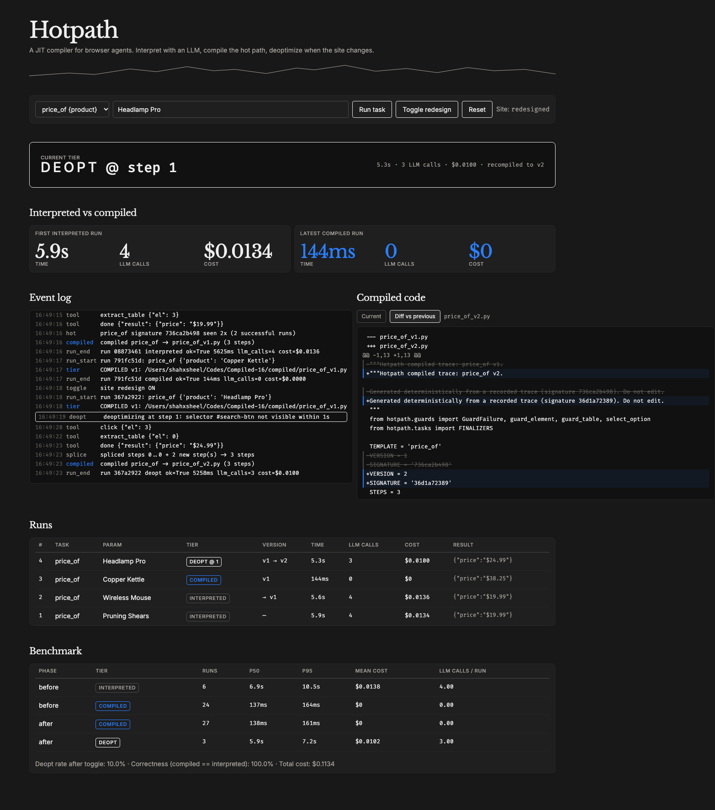

# Hotpath: a JIT compiler for browser agents

An LLM browser agent is a slow, expensive interpreter: every run asks Claude to read the page and decide each click. Hotpath records what the agent does and counts identical traces per task. Once a trace is hot (2 successful runs with the same signature), a deterministic compiler (no LLM) turns it into plain Playwright code, with a guard before every step. Later runs use the compiled code: about 140 ms and $0, against about 7 s and $0.014 interpreted. When the site changes and a guard fails, Hotpath **deoptimizes at that exact step**. The LLM takes over from the live page, finishes the task, and its new steps are spliced onto the steps that still worked and recompiled as the next version.



*Dashboard right after a real-model deopt (run 4 of the demo script): the tier indicator, live SSE log, stat cards, runs table, v1→v2 diff, and benchmark table.*

## Architecture

```
                 ┌──────────────────────── hotpath.runtime ─────────────────────────┐
  run(task,      │                                                                   │
      params) ──►│  compiled/<task>_v<k>.py exists?                                  │
                 │     │ no                                  │ yes                   │
                 │     ▼                                     ▼                       │
                 │  INTERPRETER (Claude Sonnet 5.5)       COMPILED run(page, params) │
                 │  tools: click/fill/extract_table/done   guard_element: visible≤1s │
                 │  sees compact DOM: [i] tag "label"        + fingerprint match     │
                 │  el index ─► canonical selector         guard_table: columns +    │
                 │  ≤15 tool calls, trace + metrics          price regex             │
                 │     │ ok                                 │ GuardFailure(step k)   │
                 │     ▼                                    ▼                        │
                 │  HOTNESS (hot.json)                   DEOPT @ step k              │
                 │  normalize ─► slot params ─► sig       interpreter resumes on the  │
                 │  2× same sig (or best of 3) ─┐         CURRENT page with steps     │
                 │                              │         0..k-1 marked done          │
                 │                              ▼                   │                │
                 │                   COMPILER (deterministic) ◄─────┘ splice          │
                 │                   trace ─► Python + guards        prefix+suffix   │
                 │                   ─► compiled/<task>_v<k+1>.py                     │
                 └───────────────────────────────────────────────────────────────────┘
                        │ events (SSE)                     ▲ Playwright (Chromium)
                        ▼                                  │
               Dashboard  /  (Altitude UI)           Target site /shop (+ POST /toggle)
```

The pieces, one module each under `hotpath/`: `dom.py` (compact DOM, canonical selectors, fingerprints), `interpreter.py`, `trace.py` (normalize, slot, signature, splice), `hotness.py` (counts, variants, backoff), `invariants.py` (learned value guards), `compiler.py`, `guards.py`, `tasks.py` (templates, schemas, finalizers, JSON lookup templates), `runtime.py` (tiers, deopt, side exits, shadow checks), `ci.py` (`hotpath ci`), `server.py`, `shop.py` (demo site + stress modes).

## Run it

```bash
make setup                 # uv venv (Python 3.11) + deps + Chromium
export ANTHROPIC_API_KEY=...

make demo                  # http://127.0.0.1:8000/ (dashboard) and /shop (target site)
make demo-show             # same, with the agent's browser visible (python -m hotpath --show)
make demo-fake             # offline: scripted fake LLM instead of Claude

make test                  # unit + integration (fake LLM) + Playwright UI + 1 live smoke test (skipped without a key)
make bench                 # 3 tasks x 10 runs, toggle, 10 more each -> bench.json
```

Equivalent raw commands: `.venv/bin/python -m hotpath [--show] [--fake] [--port 8000]`, `.venv/bin/python -m pytest -q`, `.venv/bin/python bench.py [--fake] [--runs 10]`.

### Demo script

On the dashboard, pick `price_of {product}`:

1. **Run task**: INTERPRETED. Claude fills the search box, clicks Search, extracts the table, and calls `done` (~6 s, 4 LLM calls).
2. **Run task** again: INTERPRETED. Same signature twice, so it compiles to `price_of_v1.py` (shown in the code viewer).
3. **Run task**: COMPILED. ~150 ms, 0 LLM calls, $0. Try a different product; the param is a slot.
4. **Toggle redesign**: the site renames the submit button and table, reorders the columns, and moves the search form into a sidebar.
5. **Run task**: DEOPT @ STEP 1 (`selector #search-btn not visible within 1s`). Step 0 (fill `#q`) still passes. Claude finishes from the live page, the suffix is spliced on, and it recompiles to v2. **Diff vs previous** shows `#search-btn → #go-btn` and `#results → #product-grid`.
6. **Run task**: COMPILED v2.

## Tasks

| id | param | result |
|---|---|---|
| `price_of` | `{product}` | `{"price": "$19.99"}` |
| `top3_in` | `{category}` | `[{"name","price","stock"} x3]` |
| `stock_for` | `{term}` | `{"stock": 31}` |

`done()` is schema-validated, and compiled runs return the output of hand-written finalizers in `tasks.py`, so the two tiers' outputs compare field by field.

## Benchmark (real model, `claude-sonnet-5-5`)

`bench.py`: 3 tasks x 10 runs with a different param each run, then one redesign toggle, then 10 more each (60 runs).

| phase | tier | runs | p50 | p95 | mean cost | LLM calls/run |
|---|---|---:|---:|---:|---:|---:|
| before | interpreted | 6 | 6.87 s | 10.53 s | $0.0138 | 4.00 |
| before | compiled | 24 | 137 ms | 164 ms | $0 | 0.00 |
| after | compiled | 27 | 138 ms | 161 ms | $0 | 0.00 |
| after | deopt | 3 | 5.93 s | 7.24 s | $0.0102 | 3.00 |

- Deopt rate after the toggle: **10%** (one deopt per task, then v2 handles the rest)
- Correctness (compiled/deopt output == expected interpreted output): **100%** (60/60 runs succeeded)
- Total cost: **$0.113** for 60 runs, versus about $0.83 if every run had been interpreted. Compiled runs are about **50x faster** at p50.

## Results: is it worth putting in a pipeline?

All numbers below are live runs against the real model. Raw data: [`pipeline.md`](pipeline.md), [`compare.md`](compare.md), [`compare_baseline.md`](compare_baseline.md) (before the fixes).

### CI pipeline simulation (Sonnet 5.5, 9 checks per build, `pipeline_sim.py`)

Three ways to run the same checks over six builds. A build is **right** when it is green without a regression and red with one.

| build | site | Hotpath | Hotpath cost / time | frozen Playwright suite | LLM agent, every check | LLM cost / time |
|---|---|---|---:|---|---|---:|
| main #1 (cold cache) | original | ✅ 9/9 | $0.081 / 46.8s | ✅ 9/9 | ✅ 9/9 | $0.121 / 54.5s |
| main #2 | original | ✅ 9/9, all compiled | **$0.000 / 1.5s** | ✅ 9/9 | ✅ 9/9 | $0.121 / 54.5s |
| PR #7: UI refactor | redesign | ✅ 9/9, 3 self-healed | $0.030 / 19.5s | ❌ 0/9 (false red) | ✅ 9/9 | $0.122 / 71.4s |
| PR #7 re-run | redesign | ✅ 9/9, all compiled | **$0.000 / 1.4s** | ❌ 0/9 (false red) | ✅ 9/9 | $0.122 / 71.4s |
| main #3 | original | ✅ 9/9, cached v1 reused | **$0.000 / 4.7s** | ✅ 9/9 | ✅ 9/9 | $0.121 / 54.5s |
| PR #8: breaks price formatting | cents | ✅ red (3/9), flagged | $0.068 / 35.8s | ✅ red (3/9) | ✅ red (4/9) | $0.122 / 53.0s |
| **total** | | **6/6 right** | **$0.179 / 110s** | 4/6 right | 6/6 right | $0.730 / 360s |

Hotpath matches the LLM agent's judgement at a quarter of the cost and a third of the time, and avoids the frozen suite's false reds after a UI refactor.

### Stress tests: compiled code meets a changed site (`compare.py`, 3 trials, 2 models)

Six site changes (structural: redesign, renamed inputs, relabelled button, decoy table; semantic: prices in cents, swapped Price/Stock headers). Each run is **correct**, **flagged** (wrong, but Hotpath raised a flag), or **silent** (wrong, and nobody was told).

| | Hotpath, Sonnet 5.5 | Hotpath, Sonnet 4.6 | LLM alone, Sonnet 5.5 | LLM alone, Sonnet 4.6 |
|---|---:|---:|---:|---:|
| correct | 66/72 | 68/72 | 33/36 | 33/36 |
| **silent wrong** (95% upper bound) | **0/72 (≤5%)** | **0/72 (≤5%)** | 3/36 (≤22%) | 3/36 (≤22%) |
| cost / run, p50 latency | $0.0053, 1.6 s | $0.0067, 1.4 s | $0.0136, 6.0 s | $0.0179, 5.7 s |

Before the fixes below, the same suite gave Hotpath **4 silent wrong answers out of 24** per model. Elsewhere in the run: 60/60 deopts recovered, compiled answers 100% correct, shop benchmark 100% correct at $0.114 vs $0.833 all-interpreted, books.toscrape.com 9/9 on both models.

### What changed to get there (each borrowed from published work)

| Technique | Inspired by | Effect |
|---|---|---|
| **Learned value guards**: character-class patterns inferred from interpreted runs, only for columns the answer was read from | Daikon (likely invariants), Auto-Validate (SIGMOD '21) | Cents / swapped headers now deopt and flag instead of returning wrong prices |
| **Backoff instead of futile recompiles**: if the healed trace would compile to identical code, skip compiled code for 2, 4, 8, 16 runs (flagged) | Tracing JITs (PyPy guard-failure thresholds) | No endless deopt loop on data drift |
| **Polymorphic cache**: up to 4 compiled versions per task, tried before calling the LLM | Polymorphic inline caches | Switching main ↔ PR branch costs $0 |
| **Param-targeted clicks + side exits**: a click whose label is a param is resolved by label at run time; input misses fall back without splicing | Found on books.toscrape.com | Fixed wrong answers for every title but the first, and trace bloat |
| **Shadow verification** (optional): re-derive every Nth compiled answer with the interpreter; mismatch invalidates | AgentRR's check function, differential testing | A sampled, measurable silent-error rate |

**Ablation** ([`compare_ablation_shadow.md`](compare_ablation_shadow.md), Sonnet 5.5): with learned guards off and a shadow check on *every* compiled run, Hotpath had **6/72 silent wrong** answers at +$0.62 for 45 checks. Shadow checks caught the swapped headers (3 mismatches, each discarding the compiled version) but never the cents case, because the interpreter makes the same mistake and agrees. Learned guards are the defense that matters (0/72, $0 at run time); shadow checks only add coverage for errors the LLM doesn't share.

### Use it in CI

```bash
python -m hotpath ci examples/shop-checks.json --junit hotpath.xml --summary "$GITHUB_STEP_SUMMARY"
python -m hotpath ci examples/shop-checks.json --fake --serve-demo     # offline smoke test against the bundled demo
```

Checks are JSON (`template`, `params`, `expect`). New tasks can be declared in the same file as table lookups (`match_column`, `return_columns`), with no Python. Cache `.hotpath/ci` between builds so repeat runs are compiled. Self-heals are reported as warnings with the code diff. The exit code is 1 on a wrong result (and on flags with `--strict`). Example workflow: [`examples/github-actions.yml`](examples/github-actions.yml).

### What we can and cannot claim

- **Supported:** near-zero cost on repeat checks, self-healing of UI refactors that break frozen Playwright suites, real regressions still caught, and **no silent wrong answers in our stress suite on two models** (the LLM alone had 3/36).
- **Not yet supported:** results in general. The demo site and all six stress modes are ours, the only outside site is one sandbox, tasks are "read a value from a table" (no multi-page flows, logins or forms), and the confidence intervals rest on 72 runs per model. The natural next step is the self-hosted WebArena benchmark used by AWM, SkillWeaver and WALT.

## Design notes

Every judgment call is logged one line at a time in [DECISIONS.md](DECISIONS.md). The spec is in [SPEC.md](SPEC.md).
